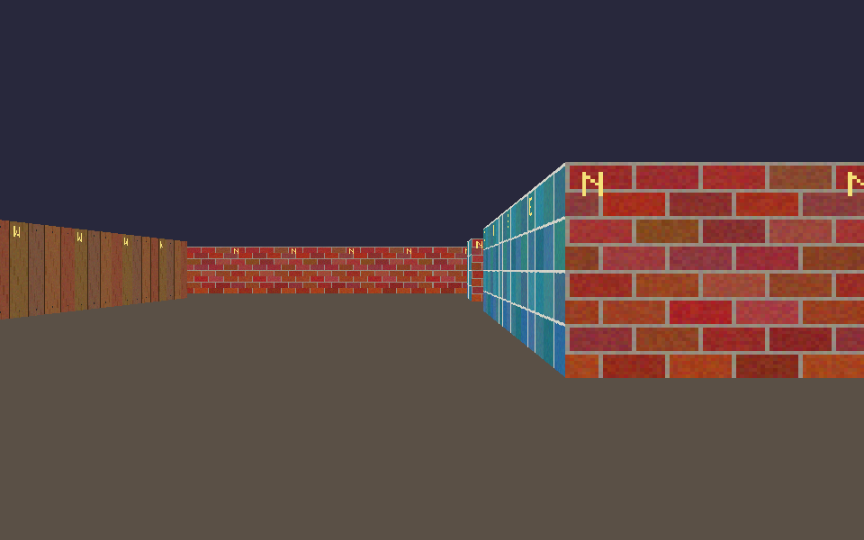

# cub3D — игра от первого лица методом рейкастинга



## Описание

cub3D — учебная лабораторная работа на Python по мотивам проекта
[cub3D школы 42](https://projects.intra.42.fr/projects/cub3d). Программа читает сцену из файла `.cub`
и рисует лабиринт от первого лица: для каждого из столбцов экрана пускается луч, алгоритм DDA
находит ближайшую стену, по перпендикулярному расстоянию считается высота полосы, а нужный
столбец текстуры растягивается на эту полосу. Такой приём называется рейкастингом
([подробный разбор](https://lodev.org/cgtutor/raycasting.html)). Библиотека `pygame-ce`
используется только для окна и вывода кадра, весь остальной код — обычный Python.

## Установка и запуск

Нужен Python 3.11 или новее. Windows (PowerShell):

```powershell
git clone https://github.com/Vasileva-Yulia/cub3d-python
cd cub3d-python
python -m venv .venv
.\.venv\Scripts\Activate.ps1
pip install pygame-ce
python main.py maps/simple.cub
```

В Linux и macOS окружение активируется командой `source .venv/bin/activate`.

Запуск: `python main.py <файл.cub> [--width W] [--height H]`. По умолчанию окно 960×600.
Запускать нужно из корня проекта: пути к текстурам в картах из `maps/` заданы относительно него.
Если файл не открылся или сцена записана неверно, программа печатает `Error` и причину
(с номером строки и колонки, где это возможно) и завершается с кодом 1; при неверных
аргументах — с кодом 2.

Готовые карты: `maps/simple.cub` (комната с колонной и стенами разных текстур), `maps/42.cub`
(цифры «42» из стен), `maps/irregular.cub` (непрямоугольная карта), `maps/maze.cub` (лабиринт).

## Управление

| Клавиша | Действие |
| --- | --- |
| W / S | идти вперёд / назад |
| A / D | шаг влево / вправо |
| ← / → | повернуть взгляд влево / вправо |
| Esc или закрытие окна | выход |

Игрок не проходит сквозь стены и останавливается в 0,2 клетки от них, а при движении под углом
скользит вдоль стены. Скорость не зависит от частоты кадров. В заголовке окна показан FPS.

## Формат карты

Файл сцены — текстовый, расширение `.cub`. Сначала идут шесть элементов, затем карта:

```
NO textures/north.png
SO textures/south.png
WE textures/west.png
EA textures/east.png

F 60,60,70
C 150,190,230

1111111111
1000000001
1001000001
1000N00101
1000000001
1011000001
1000000001
1111111111
```

- `NO`, `SO`, `WE`, `EA` — текстуры стен, которые видны при взгляде на север, юг, запад и восток
  (PNG 64×64); `F` — цвет пола, `C` — цвет потолка (три числа 0–255 через запятую).
  Элементы идут в любом порядке, каждый ровно один раз, между ними допускаются пустые строки.
- Относительный путь к текстуре ищется от текущего каталога, затем от каталога файла сцены.
  Нет файла — ошибка формата.
- Карта идёт последней и начинается с первой строки из символов карты после всех шести элементов.
  Символы: `1` — стена, `0` — пол, `N`, `S`, `E`, `W` — стартовая клетка игрока и направление
  взгляда, пробел — пустота вне карты. Строки могут быть разной длины, пустая строка внутри карты
  — ошибка, пустые строки в конце файла игнорируются.
- Игрок задан ровно один раз.
- Карта замкнута: ни одна проходимая клетка не лежит на краю карты и не граничит с пустотой — ни по
  стороне, ни по диагонали.
- Любое нарушение — ошибка формата (`SceneFormatError`), например
  `строка 10, колонка 4: недопустимый символ '2' в карте`. Примеры ошибочных карт —
  в `maps/bad/`, по одной на каждую ошибку.

## Структура проекта

```
main.py               запуск: аргументы, вывод ошибок, коды возврата
cub3d/
  errors.py           исключения CubError, SceneFormatError, RaycastError
  scene.py            модель сцены: текстуры, цвета, карта, старт игрока, is_wall
  parser.py           разбор файла .cub: элементы, карта, цвета, замкнутость
  player.py           игрок: позиция, взгляд, плоскость камеры, поворот
  movement.py         движение с отступом от стен и скольжением
  camera.py           луч для каждого столбца экрана
  raycast.py          алгоритм DDA, перпендикулярное расстояние, высота полосы
  texture.py          столбец текстуры (с отражением) и видимые строки
  window.py           единственный модуль с pygame: окно, отрисовка, клавиши
maps/                 примеры сцен, maps/bad/ — сцены с ошибками формата
textures/             текстуры стен 64×64
tests/                тесты (pytest)
tools/render_png.py   один кадр сцены в PNG без окна
tools/measure_fps.py  замер времени кадра
docs/                 снимок экрана для README
```

Данные проходят цепочку: файл сцены → парсер → сцена → рейкастинг → отрисовка. Каждый этап —
отдельный модуль, поэтому парсер, модель, рейкастинг и построение кадра проверяются тестами без окна.

## Тесты

```
pip install pytest mypy ruff
pytest -q
mypy --strict cub3d main.py
ruff check .
ruff format --check .
```

Тестами покрыты парсер (все ошибки формата с текстом сообщений, цвета), модель игрока (стартовые
векторы, повороты, движение, блокировка стеной, скольжение), рейкастинг (лучи по осям и под углом,
отсутствие «рыбьего глаза», высота полосы, отражение столбца текстуры) и кадр без окна (цвета пола и
потолка, полоса известной высоты). Окно и обработка клавиш тестами не покрываются. Всего 116 тестов.

## Производительность

Замеры сделаны скриптом `tools/measure_fps.py` на сцене `maps/maze.cub`: 300 кадров, игрок между
кадрами поворачивается, в кадр входят лучи, текстуры и `flip`. Три запуска подряд.

| Что измерялось | Сцена | Разрешение | мс/кадр | FPS | Машина |
| --- | --- | --- | --- | --- | --- |
| 960 лучей без отрисовки | maps/maze.cub | 960×600 | 4,4–5,5 | — | Intel64 Family 6 Model 158, Windows 11 |
| Полный кадр, среднее | maps/maze.cub | 960×600 | 17,6–18,0 | 56–57 | Intel64 Family 6 Model 158, Windows 11 |
| Полный кадр, худший из 300 | maps/maze.cub | 960×600 | 28,1–31,2 | 32–36 | Intel64 Family 6 Model 158, Windows 11 |

Процессор: Intel64 Family 6 Model 158 Stepping 10 (GenuineIntel); Python 3.14.7, pygame-ce 2.5.8.

Норматив — не менее 30 FPS при ширине полосы 1 пиксель — выполняется, причём даже худший кадр
укладывается в 33 мс. Основная цена кадра — не лучи, а масштабирование столбцов текстур и вывод на
экран. Столбец текстуры нарезается на 64 поверхности шириной в 1 пиксель при загрузке, а для столбца
экрана масштабируется одним вызовом `pygame.transform.scale` и копируется одним `blit`. В самом
окне частота кадров ограничена 60 в секунду.

Повторить замер: `python tools/measure_fps.py maps/maze.cub`.

## Автор

Васильева Юлия Максимовна, группа 23ИТ-ПИ(б/о)ПИП-1
